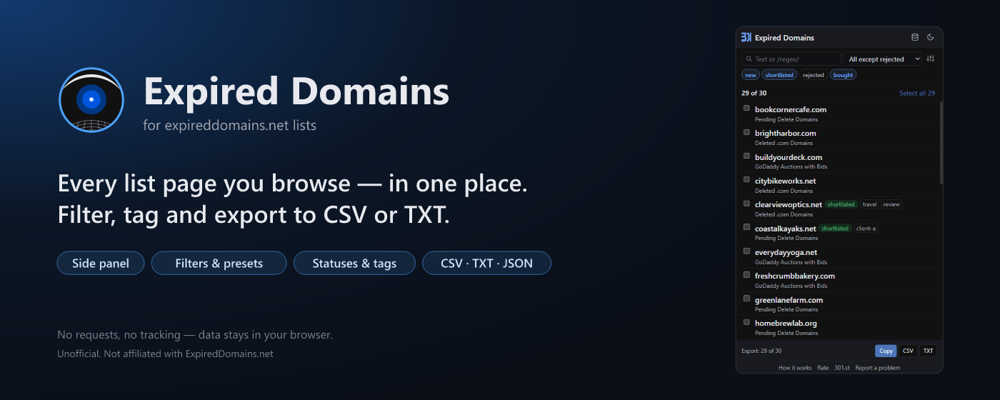

# Expired Domains

Browser extension by [301.st](https://301.st) that saves domain lists from expireddomains.net
pages **you open yourself**, keeps them across pages in one collection, and lets you filter,
mark and export them to CSV, TXT or the clipboard.

[](LICENSE)

Unofficial. Not affiliated with ExpiredDomains.net.

## Install

Chrome Web Store, Edge Add-ons and Firefox Add-ons — links will appear here once the
extension passes review. Every store package is built by GitHub Actions on Linux and attached
to the matching [GitHub Release](https://github.com/investblog/expired-domains/releases).

## How it works

The extension sends no requests of its own. It reads the domain table of the page that is
already open in your tab and stores the rows locally in the browser.

[ExpiredDomains.net](https://www.expireddomains.net/) is a free service that lists deleted,
expiring and auction domains as paged tables. Most domain lists are shown only after you
sign in; a [free account](https://www.expireddomains.net/register/) is enough. A welcome
page with these steps opens once after installation; later it is under "How it works" in
the side panel.

- Sign in to expireddomains.net, then open a domain list. A small panel appears on the right:
  "On page: 25 · page 1 of 58,270".
- Press **Save page**, or turn on **Auto-capture**: every list page you open is then saved
  after it loads. The extension never opens the next page for you.
- The toolbar badge shows how many domains are collected.
- Click the toolbar icon to open the side panel (in every browser; there is no popup) and
  review the collection while you keep browsing. It updates by itself.

## Features

- **Filters** in a slide-out panel: text or `/regex/`, status, tags, source list,
  available/registered, data age, drop date, deletion date, running auctions, BL/DP/archive
  thresholds, archive age, name length, zones, no digits, no hyphens.
- **Presets:** "All except rejected" (default), "Working — drops", "Working — auctions", plus
  up to 20 of your own.
- **Statuses, tags and notes** per domain; bulk actions for the whole filter result.
- **Export** of the current filter result: CSV (RFC 4180, UTF-8 with BOM), TXT, clipboard.
- **Backup / restore** of everything as JSON (merge or replace).
- **English and Russian** interface; light, dark and system theme.

### CSV and Excel

The CSV uses `,` as the separator. In Excel, open it through **Data → From Text/CSV**; a
double click opens it correctly only where the list separator is `,`. Values that could be
read as formulas get a leading `'`.

## Privacy

- No network requests, analytics, telemetry or remote code.
- Read from the site: the `#listing` block (domain rows and their columns), the list address
  (host, path and the search `q`), the page title and the page counter. Nothing outside the
  listing: not your account name, e-mail or balance.
- Everything stays in `storage.local` of your browser. Remove it with **Clear** or by
  uninstalling the extension.

Privacy policy: <https://301.st/apps-privacy>

How fast you browse the site is up to you; respect its rules.

## Permissions

| Permission | Why |
|---|---|
| Access to `*.expireddomains.net` (content script) | read the domain table of the page you opened |
| `storage` | keep the collection and settings locally |
| `unlimitedStorage` | up to 10,000 domains with all columns can exceed the 10 MB default quota |
| `sidePanel` (Chrome, Edge) | keep the list open beside the site while you browse |

## Development

Node.js 22, npm. Stack: WXT, TypeScript, vanilla DOM, Biome, Vitest.

```sh
npm ci
npm run dev            # Chrome with live reload (dev:firefox for Firefox)
npm run check          # types, lint, tests, build of all three packages, invariant scan
npm run zip:all        # store packages and the source archive in dist/
npm run icons          # rasterise src/public/icons/icon.svg
npm run store:harness  # demo side panel for store screenshots (see docs/store-listings/)
npm run promo          # store promo tiles from SVG
```

The specification is [docs/SPEC.md](docs/SPEC.md); decisions are in
[docs/decisions/](docs/decisions/); changes are in [CHANGELOG.md](CHANGELOG.md).
`npm run check` includes `scripts/check-invariants.mjs`, which fails the build if network
APIs, site control or extra permissions appear.

### Releases

Tags are created only by the **Cut release** workflow after the full quality gate on Linux;
**Release** attaches the three store packages, the source archive and `SHA256SUMS.txt` to the
GitHub Release, and **Submit to stores** uploads them (v0.1.0 is submitted by hand).
Firefox reviewers build from source as described in [AMO_BUILD.md](AMO_BUILD.md).

## License

[Apache-2.0](LICENSE) · by [301.st](https://301.st)
